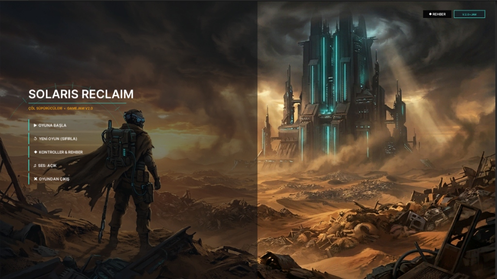
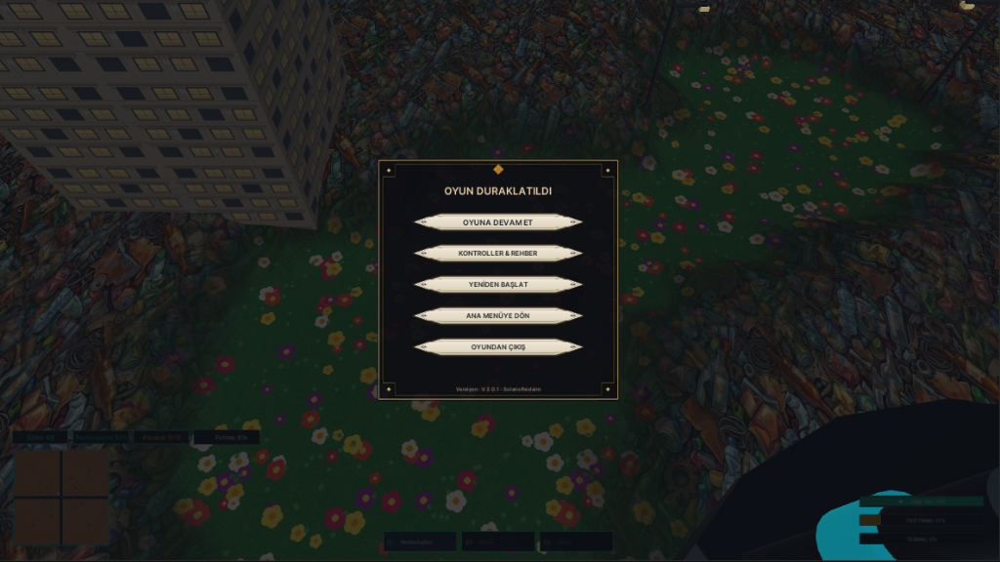

# ☀️ SOLARIS: RECLAIM
### *Çöl Süpürücüleri • GameUp Türkiye | COP31 Temalı Hackathon*

<div align="center">



[](https://unity.com/)
[](https://github.com/ReKara12/Solaris)
[](https://github.com/ReKara12/Solaris)
[](LICENSE)

**"Terk edilmiş bir şehir, metrelerce çöp katmanı ve amansız solar fırtınalar...  
Mete, Solaris'i atık canavarlarından temizleyip yeşil doğayı yeniden yeşertebilecek mi?"**

[🎮 Oynanış Videosu / Referans](https://www.youtube.com/watch?v=3r8gL1vWGx0&list=PLsGBNq2i4TkLQeE8IhuS2aCqhKnGIktHB&index=8) • [📖 Hikaye](#-hikaye) • [⚡ Temel Mekanikler](#-temel-mekanikler) • [🕹️ Kontroller](#%EF%B8%8F-kontroller) • [📦 CC0 Varlıklar](#-kullan%C4%B1lan-cc0--a%C3%A7%C4%B1k-kaynak-varl%C4%B1klar)

</div>

---

## 📖 Hikaye

Yıllar önce insanlık, kontrolsüz tüketim ve sıfır atık bilincinin terk edilmesi sonucu **Solaris** şehrini devasa bir atık yığınına dönüştürdü. Geri dönüşümün yapılmadığı bu metropolde, biriken zehirli atık dağları zamanla mutasyona uğrayarak şehri işgal eden ölümcül **Atık Canavarları**na dönüştü. İklim krizinin tetiklediği şiddetli **Solar Fırtınalar** şehri kavururken, insanlar şehri kaderine terk etti.

İnsanlığın son umudu olarak şehre tek bir otonom temizlik ve geri dönüşüm robotu gönderildi: **METE**.

Mete'nin görevi:
1. Şehrin üzerine çöken metrelerce kalınlıktaki çöp tabakasını yüksek güçlü siklonik vakumuyla temizlemek,
2. Çöplerin altına gömülmüş güneş panellerini, enerji istasyonlarını ve iklim kulelerini yeniden gün ışığına çıkarmak,
3. Atıklardan dönüştürdüğü silika ve hurda metallerle cephaneliğini geliştirip atık canavarlarına karşı hayatta kalmak,
4. Çorak çöp çölünün altındaki gizli tohumları uyandırıp şehri yemyeşil bir vahaya dönüştürmek!

---

## 🌍 Temalar ve Küresel Mesaj

| Tema | Oyundaki Karşılığı ve Felsefesi |
| :--- | :--- |
| ♻️ **Sıfır Atık (Zero Waste)** | Oyunda hiçbir şey israf edilmez. Süpürülen her çöp parçası; zırh onarımı, otonom süpürücü dronlar veya enerji için **Silika**ya dönüştürülür. |
| 🔥 **Küresel Isınma & İklim Krizi** | Şehri periyodik olarak vuran acımasız Solar Fırtınalar, yüksek sıcaklık stresi ve aşırı ısınma (Overheat) tehlikesi iklim tahribatının somut yüzünü yansıtır. |
| 🔄 **Döngüsel Ekonomi & Geri Dönüşüm** | Cephanelikteki tüm silahlar ve mühimmatlar geri dönüştürülmüş kentsel atıklardan (cam kırıkları, hurda metal, sismik moloz ve cüruf lavı) üretilir. |

---

## 📸 Ekran Görüntüleri

<div align="center">

### 🌆 Solaris: Reclaim — Ana Menü & İklim Kulesi
*Metropolün merkezindeki İklim Kulesi ve solar toz fırtınasının ortasında kahramanımız Mete.*


### 🌱 Dinamik Çöp Kazıma ve Doğa Restorasyonu
*Vakumla temizlenen 2.4 metrelik zehirli çöp katmanının altından fışkıran çiçekler ve yeşil örtü.*


</div>

---

## ⚡ Temel Mekanikler

### 🌪️ 1. Gerçek Zamanlı Arazi Kazıma (Realtime Excavation & Restoration)
- **160x160 Dinamik Yükseklik Haritası**: 2.4 metre derinliğindeki çöp tabakası gerçek zamanlı olarak kazınır.
- **Toprak & Çiçek Uyanışı**: Vakumla temizlenen her metrekare, altındaki verimli yeşil çimenleri ve çiçek açan ekosistemi ortaya çıkarır.
- **Gömülü Binalar & Güneş Panelleri**: Çöpler temizlendikçe devasa gökdelenler ve güneş enerjisi panelleri araziden yukarı yükselerek şehre yeniden güç sağlar.
- **[T] Vaha Ağacı Dikimi**: Temizlenen alanlara ağaç dikerek ekolojik restorasyon hızlandırılabilir.

### ⚔️ 2. Geri Dönüştürülmüş Cephanelik (Recycled Arsenal)
Solaris sokaklarındaki atıklar dönüştürülerek 4 farklı yıkıcı silaha ev sahipliği yapar:
1. **Pnömatik Hurda Zıpkını (Scrap Harpoon)** *(Başlangıç Silahı)*:
   - Ağır hurda metal mızrağı. Düşmanları geriye savurur; canavarlar duvara çarptığında ezilerek sersemletilir.
2. **Kristal Kıymık Pompalısı (Glass Shotgun)**:
   - Geri dönüştürülmüş silika cam parçacıkları fırlatan 8 parçalı konik yakın mesafe av tüfeği.
3. **Termal Cüruf Püskürtücü (Slag Torch)**:
   - Akışkan akkor cüruf fırlatır. Yerde erimiş magma birikintileri bırakarak geçen canavarları yakar.
4. **Sismik Moloz Havanı (Seismic Debris Mortar)**:
   - Parabolik atışla fırlatılan ağır kentsel moloz bombası. Çarptığı yerde sismik şok dalgası oluşturur.

### 🌡️ 3. Termal Isı Yönetimi & Aşırı Isınma (Heat & Venting)
- Ateş etmek ve yoğun vakum kullanmak Mete'nin gövde sıcaklığını artırır.
- **Overheat**: Isı %100'e ulaştığında sistem kilitlenir.
- **[Left Shift] Termal Tahliye (Slag Vent Blast)**: Acil durumlarda gövdedeki ısının %65'ini dışarı buhar ve şok dalgası olarak patlatarak düşmanları sersemletir.

### ☀️ 4. Solar Fırtına Döngüsü (Solar Storm)
- Belirli aralıklarla şehri vuran güneş fırtınası görüş mesafesini daraltır, fırtına rüzgarı robotu iter ve hareket kabiliyetini sınırlar.
- Fırtına sırasında enerji tüketimi artarken, fırtına dindiğinde şehirde kısa bir temizleme penceresi açılır.

### 🛸 5. Otonom Süpürücü Dronlar (Sweeper Drones)
- Toplanan silikalarla üretilen yardımcı mini dronlar, Mete'nin etrafında devriye gezerek çevredeki çöpleri otonom olarak temizler.

---

## 🕹️ Kontroller

| Tuş | Eylem | Açıklama |
| :---: | :--- | :--- |
| <kbd>W</kbd> <kbd>A</kbd> <kbd>S</kbd> <kbd>D</kbd> | **Hareket** | Mete'yi 3D düzlemde yönlendirir |
| <kbd>Fare Sol Tık</kbd> / <kbd>E</kbd> | **Siklonik Vakum** | Çöpleri vakumlar, araziyi kazar ve silika toplar |
| <kbd>Fare Sağ Tık</kbd> | **Silah Ateşleme** | Aktif geri dönüşüm silahını ateşler |
| <kbd>1</kbd> <kbd>2</kbd> <kbd>3</kbd> / <kbd>Tekerlek</kbd> | **Silah Değiştir** | Cephanelikteki 3 aktif yuva arasında geçiş yapar |
| <kbd>Space</kbd> | **Eko-Dash** | Hasarsızlık pencereli (i-frame) hızlı kaçınma atılması |
| <kbd>Left Shift</kbd> | **Termal Boşaltma** | %65 Isıyı anında tahliye eden patlayıcı şok buharı |
| <kbd>Q</kbd> | **Hurda Zıpkın Kısayolu** | Doğrudan ağır hurda mızrağı fırlatır |
| <kbd>R</kbd> | **Toz & Hurda Eritme** | Toz tankındaki atıkları kalıcı Silika kaynağına dönüştürür |
| <kbd>T</kbd> | **Vaha Ağacı Dik** | Temizlenen toprağa vaha fidanı diker |
| <kbd>ESC</kbd> | **Duraklatma** | Duraklatma, ayarlar ve rehber menüsünü açar |

---

## 📦 Kullanılan CC0 / Açık Kaynak Varlıklar

Proje geliştirilirken açık kaynak, kamu malı (Public Domain) ve CC0 lisanslı varlıklardan faydalanılmıştır:

### 1. 3D Karakter ve Sci-Fi Modelleri (Three.js CC0/MIT)
- [Soldier.glb](https://raw.githubusercontent.com/mrdoob/three.js/r128/examples/models/gltf/Soldier.glb) — *Yürüme, koşma ve bekleme animasyonlu modüler humanoid bedevi/asker karakteri.*
- [RobotExpressive.glb](https://raw.githubusercontent.com/mrdoob/three.js/r128/examples/models/gltf/RobotExpressive/RobotExpressive.glb) — *Çöl süpürme/temizleme otomasyonu için ifadeli temizlik robotu.*
- [Xbot.glb](https://raw.githubusercontent.com/mrdoob/three.js/r128/examples/models/gltf/Xbot.glb) — *Riglenmiş insanımsı ajan / scout modeli.*
- [PrimaryIonDrive.glb](https://raw.githubusercontent.com/mrdoob/three.js/r128/examples/models/gltf/PrimaryIonDrive.glb) — *Şehir merkezindeki İklim Kulesi ve reaktör motoru için sci-fi iyon çekirdeği.*

### 2. Harici Ses Efektleri (Public Domain / MIT Audio)
- [sandstorm_wind_remote.ogg](https://raw.githubusercontent.com/mrdoob/three.js/dev/examples/sounds/376737_Skullbeatz___Bad_Cat_Maste.ogg) — *Çöl rüzgârı ve kum fırtınası atmosferik döngü sesi.*
- [ping_remote.mp3](https://raw.githubusercontent.com/mrdoob/three.js/dev/examples/sounds/ping_pong.mp3) — *UI tıklama ve bildirim sesi.*

### 3. Kullanılan / Referans Alınan Açık Kaynak CC0 Platformları
- **[Kenney Assets (CC0 Public Domain)](https://kenney.nl/assets)**:
  - [Kenney Space Kit](https://kenney.nl/assets/space-kit) *(Sci-Fi üs, anten ve enerji modelleri)*
  - [Kenney City / Isometric Roads](https://kenney.nl/assets/isometric-roads) *(Bulvarlar ve yol ağı)*
- **[Poly Pizza (CC0 Low-Poly Modeller)](https://poly.pizza)** — *Düşük poligonlu çöl ağaçları, kayalar ve harabeler.*
- **[AmbientCG (CC0 PBR Dokular)](https://ambientcg.com)** — *Asfalt, toprak ve kaya kaplamaları.*
- **Görsel & Atmosferik İlham**: [YouTube Referansı](https://www.youtube.com/watch?v=3r8gL1vWGx0&list=PLsGBNq2i4TkLQeE8IhuS2aCqhKnGIktHB&index=8)

---

## 🛠️ Kurulum & Geliştirici Rehberi

### Gereksinimler
- **Unity 6** (Tavsiye edilen sürüm: `Unity 6000.0.50f1` veya güncel Unity 6 LTS)
- **Git** & **Git LFS**

### Çalıştırma Adımları
1. Projeyi klonlayın:
   ```bash
   git clone https://github.com/ReKara12/Solaris.git
   cd Solaris
   ```
2. **Unity Hub** uygulamasını açın.
3. **Add** butonuna tıklayarak klonladığınız `Solaris` klasörünü seçin.
4. Unity editörü açıldığında:
   - Proje panelinden `Assets/Scenes/MainScene.unity` sahnesini açın.
   - Editör üst panelindeki **▶ Play** butonuna basarak oyunu hemen başlatın!
   *(Oyun ilk açılışta `SolarisGameManager.AutoBootstrapOnPlay()` sayesinde sahne eksik olsa dahi tüm grid, arazi, oyuncu ve UI hiyerarşisini otonom olarak ayağa kaldırır).*

---

## 🏆 Hackathon & Ekip

- **Etkinlik**: GameUp Türkiye | COP31 Temalı Hackathon
- **Geliştirici**: [ReKara12 (Muhammet Reşat Karaarslan)](https://github.com/ReKara12)
- **Tür**: Roguelike / Cleaning Simulator / Action Shooter
- **Vizyon**: Çevre kirliliği, iklim krizi ve atık yönetimi konularında farkındalık yaratan, oyuncuyu sadece bir yok edici değil aynı zamanda bir **onarıcı ve dönüştürücü** kılan dinamik oyun deneyimi.

<div align="center">
<i>"Gelecek, geride bıraktıklarımızı dönüştürme cesaretimizde gizlidir."</i>
</div>
